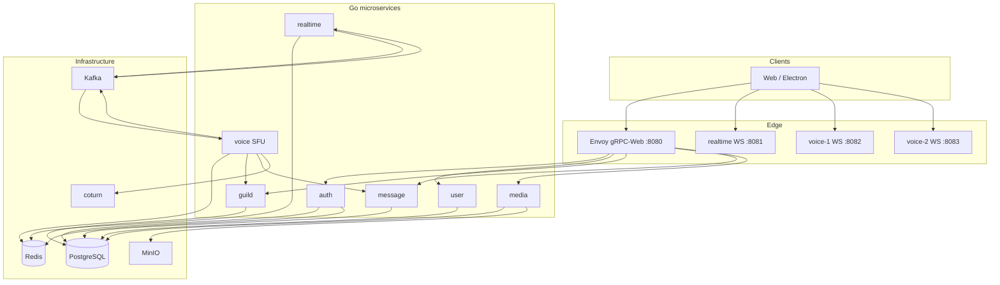

# Rokko — open-source messenger backend

**Rokko** is an open-source backend foundation for a Discord-style messenger. You can clone this repository, run it locally, and adapt branding, policies, and UI to your product. The backend is written in **Go** using a **microservice** architecture; a reference **Electron + Next.js** client lives in `frontend/`.

---

## Backend stack

| Layer | Technologies |
|--------|----------------|
| Language & modules | Go 1.25+, [`go.work`](backend/go.work) monorepo |
| RPC & API gateway | gRPC, [Connect](https://connectrpc.com/) (generated TS clients), **Envoy** gRPC-Web on `:8080` |
| Data | **PostgreSQL** (database per service), **pgx**, embedded SQL migrations |
| Cache & realtime fan-out | **Redis** (presence, subscriptions, voice room registry) |
| Events | **Apache Kafka**, transactional **outbox** pattern |
| Object storage | **MinIO** (S3-compatible) for attachments |
| Voice / video | **Pion WebRTC** SFU, **coturn** (TURN), simulcast layers `q` / `h` / `f` |
| Auth | JWT (Ed25519), refresh tokens in Redis |
| Observability (voice) | Prometheus `/metrics`, structured logs (zap) |
| Contracts | **Protobuf** + [buf](backend/proto) → Go & TypeScript in `backend/gen` |

**Microservices:** `auth`, `user`, `guild`, `message`, `media`, `realtime`, `voice` (horizontally scalable nodes).

---

## Architecture



**Call flow (simplified):**

1. Client obtains JWT via `auth` (through Envoy).
2. **Signaling & chat events:** WebSocket to **realtime** (`voice.call.ring`, `voice.state.updated`, typing, presence).
3. **Media path:** Client calls **`GET /rooms/resolve`** on any voice node → receives `ws_url` of the node that owns the room.
4. **WebSocket** to voice → first message `join` → server sends **`config`** with STUN/TURN (short-lived TURN credentials).
5. **WebRTC** (audio/video) terminates on the SFU; RTP is forwarded between peers (not a browser mesh).

---

## Repository layout

```
Rokko-free/
├── backend/
│   ├── pkg/                 # Shared libraries (postgres, redis, kafka, outbox, jwt, …)
│   ├── proto/               # Protobuf service definitions
│   ├── gen/go/              # Generated Go gRPC / Connect code
│   ├── services/
│   │   ├── auth/            # Registration, login, JWT, refresh
│   │   ├── user/            # Profiles, friends, blocks
│   │   ├── guild/           # Servers, channels, invites, roles
│   │   ├── message/         # DMs, channel messages, outbox events
│   │   ├── media/           # Presigned uploads (MinIO)
│   │   ├── realtime/        # WebSocket gateway, Kafka → Redis → clients
│   │   └── voice/           # SFU, room registry, TURN config, metrics
│   └── deploy/
│       ├── docker-compose.yml
│       ├── envoy/           # gRPC-Web proxy
│       ├── coturn/          # TURN server config
│       └── voice/           # Per-node voice configs (voice-1, voice-2)
├── frontend/                # Reference UI (Next.js, optional for backend-only use)
└── Makefile                 # up, down, test, proto
```

Each service under `backend/services/<name>/` typically contains:

- `cmd/main.go` — entrypoint  
- `internal/` — domain, repositories, gRPC/HTTP handlers  
- `migrations/` — SQL up/down  
- `config.yaml` / `config.docker.yaml` — runtime settings  

---

## Quick start

**Requirements:** Docker (or OrbStack), Go 1.25+ for local tests, Node.js for the reference frontend.

```bash
# Start Postgres, Redis, Kafka, MinIO, coturn, all services, Envoy, two voice nodes
make up

# Reference frontend (separate terminal)
cd frontend && npm install && npm run dev
```

Default ports:

| Service | Port |
|---------|------|
| gRPC-Web (Envoy) | 8080 |
| Realtime WebSocket | 8081 |
| Voice node 1 | 8082 |
| Voice node 2 | 8083 |
| Postgres | 5432 |
| Redis | 6379 |
| Kafka | 9092 |
| MinIO API / console | 9000 / 9001 |
| TURN | 3478 |

Stop everything:

```bash
make down
```

Tests:

```bash
make test              # unit (+ race)
make test-integration  # Postgres testcontainers where tagged
```

Regenerate protos after editing `.proto` files:

```bash
make proto
```

---

## Voice & audio endpoints

Voice is **HTTP + WebSocket + WebRTC**, not gRPC. Use a valid **Bearer JWT** (same as the rest of the API).

### 1. Resolve the voice node (multi-node)

Before connecting, discover which node hosts the room:

```http
GET /rooms/resolve?kind=dm&id=<channel_id>&token=<access_token>
GET /rooms/resolve?kind=guild&id=<voice_channel_id>&token=<access_token>
```

Response:

```json
{ "ws_url": "ws://localhost:8082/ws", "node_id": "voice-1", "room": "dm:123" }
```

- `kind=dm` — 1:1 or group DM (access checked via `message` service).  
- `kind=guild` — voice channel only (`guild` service, channel type `voice`).

The reference client implements this in `frontend/src/shared/voice/session.ts` (`resolveVoiceURL`).

### 2. DM participants snapshot (any voice node)

```http
GET /rooms/dm/:id?token=<access_token>
```

```json
{ "participants": ["user_id_1", "user_id_2"] }
```

Participants are also kept in Redis for cross-node reads.

### 3. WebSocket signaling (`/ws`)

Connect to `ws_url` from resolve (or `ws://localhost:8082/ws` for single-node dev):

```
ws://host/ws?token=<access_token>
```

**First message (required within 10s):**

```json
{ "type": "join", "room_id": "<id>", "kind": "dm" }
```

**Server → client (examples):**

| Type | Purpose |
|------|---------|
| `config` | `ice_servers` (STUN + ephemeral TURN username/password) |
| `joined` / `peer_joined` / `peer_left` | Room membership |
| `offer` / `answer` / `candidate` | WebRTC negotiation |
| `reconnect` | Node draining — call `/rooms/resolve` again |
| `ring_timeout` / `declined` | Call ended on callee side |

**Client → server (after join):**

| Type | Purpose |
|------|---------|
| `offer` / `answer` / `candidate` | Standard WebRTC signaling |
| `set_layer` | Simulcast layer preference (`q`, `h`, `f`) |
| `pause_video` | Stop forwarding video for a track (save bandwidth) |
| `bwe` | Optional bandwidth hint (bps) for layer selection |

Then run **WebRTC**: one `RTCPeerConnection` per client to the SFU; add mic/camera tracks (video simulcast with `rid`: `q`, `h`, `f` recommended).

### 4. Realtime WebSocket (calls UX, not RTP)

```
ws://localhost:8081/ws?token=<access_token>
```

Used for:

- Incoming ring: event `voice.call.ring` (via Kafka → realtime)  
- Room presence: `voice.state.updated`  
- Decline: send `{ "type": "call_decline", "channel_id": "..." }` → publishes `voice.call.declined` for the voice node  

Audio/video **media never goes through realtime** — only through the voice SFU.

### 5. Health & metrics (voice)

```http
GET /health
GET /ready      # Redis (+ internal checks)
GET /metrics    # Prometheus (rooms, peers, bytes, layer switches, …)
```

### 6. TURN / NAT

- **coturn** is defined in `backend/deploy/coturn/turnserver.conf` (`use-auth-secret`).  
- Voice nodes issue time-limited credentials in the `config` message (`turn_secret` in voice YAML).  
- For production, expose TURN relay ports and set `public_ws_url` / TURN URLs to your public hostnames in `backend/deploy/voice/node*.yaml`.

---

## Customization

- Replace logos, names, and UI in `frontend/`.  
- Adjust service configs in `backend/services/*/config.yaml` and Docker overlays in `backend/deploy/`.  
- Add gRPC methods in `backend/proto`, then `make proto`.  
- Scale voice by adding more `voice-N` services in Compose sharing the same Redis registry.

---

## Known limitations (demo)

This repository is a portfolio/demo project, not a production deployment.

- `backend/deploy/keys/*` are demo JWT keys. Never reuse them. Generate your own
  with `openssl genpkey -algorithm ed25519` and mount them via secrets.
- Default credentials (`rokko/rokko`, `rokko-turn-secret`, `rokko-secret`) and published
  ports for Postgres/Redis/Kafka exist for local `docker compose up` only.
- Redis has no password/persistence; coturn has no peer IP deny-list or TLS.
  Harden before any public deployment.
- `ice_host_ip` / `turn_url` point to `127.0.0.1`; set to the public address for real use.
- Services use a single Postgres superuser and `sslmode=disable` for simplicity.

---

## License

Use and modify this project for your own messenger product. Check individual dependency licenses in `go.mod` / `package.json`.

---

<br/>

# Rokko — открытый backend мессенджера

**Rokko** — открытый исходный код backend-основы мессенджера в духе Discord. Вы можете скачать репозиторий, поднять стек локально и оформить продукт под себя: бренд, политики, клиент. Backend написан на **Go** с **микросервисной** архитектурой; эталонный клиент **Electron + Next.js** лежит в `frontend/`.

---

## Стек backend

| Слой | Технологии |
|------|------------|
| Язык и модули | Go 1.25+, монорепозиторий [`go.work`](backend/go.work) |
| RPC и шлюз | gRPC, **Envoy** gRPC-Web на `:8080`, TS-клиенты Connect |
| Данные | **PostgreSQL** (отдельная БД на сервис), **pgx**, SQL-миграции |
| Кэш и realtime | **Redis** (presence, подписки, реестр голосовых комнат) |
| События | **Kafka**, transactional **outbox** |
| Файлы | **MinIO** (S3) для вложений |
| Голос / видео | SFU на **Pion WebRTC**, **coturn**, simulcast `q` / `h` / `f` |
| Авторизация | JWT (Ed25519), refresh в Redis |
| Наблюдаемость (voice) | Prometheus `/metrics`, логи zap |
| Контракты | **Protobuf** + [buf](backend/proto) → `backend/gen` |

**Сервисы:** `auth`, `user`, `guild`, `message`, `media`, `realtime`, `voice` (несколько нод).

---

## Архитектура

Схема та же, что в английской секции выше (Mermaid в GitHub / Cursor отображается как диаграмма).

Кратко:

1. REST/gRPC через **Envoy :8080** — регистрация, серверы, каналы, сообщения, медиа.  
2. **Realtime :8081** — WebSocket: presence, typing, **сигналы звонка** (ring, state, decline).  
3. **Voice :8082 / :8083** — WebSocket + **WebRTC**: аудио и видео через SFU.  
4. **Kafka** связывает доменные события с realtime и voice; **Redis** — presence и маршрутизация комнат между нодами voice.

---

## Основные директории

```
backend/pkg/          — общие пакеты (postgres, redisx, outbox, jwt, …)
backend/proto/        — контракты сервисов
backend/services/     — микросервисы (auth, user, guild, message, media, realtime, voice)
backend/deploy/       — Docker Compose, Envoy, coturn, конфиги voice-1 / voice-2
frontend/             — опциональный UI для проверки сценариев
```

В каждом сервисе: `cmd/`, `internal/`, `migrations/`, `config.yaml`.

---

## Быстрый старт

```bash
make up
cd frontend && npm install && npm run dev
```

Остановка: `make down`.  
Тесты: `make test`, `make test-integration`.  
Proto: `make proto`.

Порты — см. таблицу в английской секции.

---

## Работа с аудио и видео (эндпоинты)

Голос — это **HTTP + WebSocket + WebRTC**, не gRPC. Нужен **JWT** (как для API).

### 1. Выбор ноды voice

```http
GET /rooms/resolve?kind=dm|guild&id=<id>&token=<access_token>
```

Ответ: `ws_url` ноды, которая ведёт комнату. Клиент подключается к этому URL.

### 2. Участники DM

```http
GET /rooms/dm/:id?token=<access_token>
```

### 3. WebSocket `/ws`

Подключение: `ws://…/ws?token=…`

Первое сообщение:

```json
{ "type": "join", "room_id": "<id>", "kind": "dm" }
```

Сервер пришлёт **`config`** с ICE (STUN/TURN), далее обмен `offer` / `answer` / `candidate`. Медиапотоки идут в SFU, не P2P-mesh.

Дополнительно: `set_layer`, `pause_video`, `bwe` — simulcast и экономия трафика.

### 4. Realtime `:8081`

WebSocket для **UX звонка**: входящий ring, список участников в канале, `call_decline`. **RTP через realtime не идёт** — только через voice.

### 5. Мониторинг voice

`/health`, `/ready`, `/metrics`.

### 6. TURN

Настройка в `backend/deploy/coturn/` и `turn_secret` в конфиге voice. Для прода укажите публичные URL в `backend/deploy/voice/node*.yaml`.

---

## Кастомизация

Смена бренда и UI — `frontend/`. Конфиги сервисов — `backend/services/*/config.yaml` и `backend/deploy/`. Новые RPC — правки в `backend/proto` и `make proto`. Масштабирование звонков — дополнительные контейнеры `voice-N` с общим Redis.

---

## Известные ограничения (демо)

Этот репозиторий — портфолио/демо, а не продакшен-деплой.

- `backend/deploy/keys/*` — демонстрационные JWT-ключи. Не переиспользуйте их. Сгенерируйте свои
  через `openssl genpkey -algorithm ed25519` и подключайте через secrets.
- Учётные данные по умолчанию (`rokko/rokko`, `rokko-turn-secret`, `rokko-secret`) и открытые
  порты Postgres/Redis/Kafka предназначены только для локального `docker compose up`.
- У Redis нет пароля и persistence; у coturn нет deny-list peer IP и TLS.
  Ужесточите конфигурацию перед любым публичным развёртыванием.
- `ice_host_ip` / `turn_url` указывают на `127.0.0.1`; для реальной сети задайте публичный адрес.
- Сервисы используют одного суперпользователя Postgres и `sslmode=disable` ради простоты.

---

## Лицензия

Используйте и изменяйте проект под свой мессенджер. Лицензии зависимостей — в `go.mod` и `package.json`.
